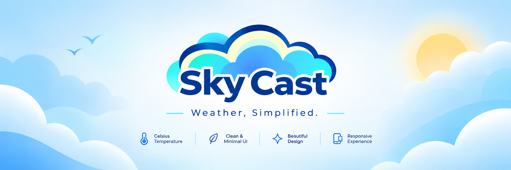
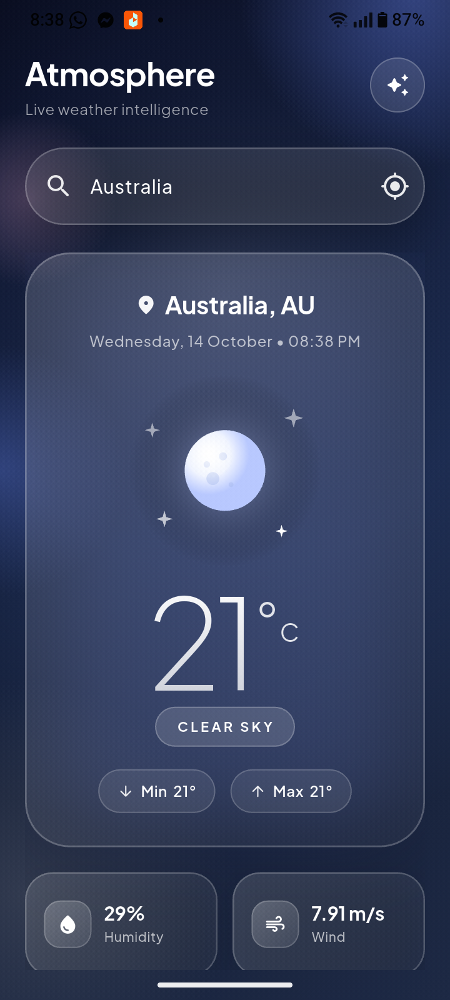
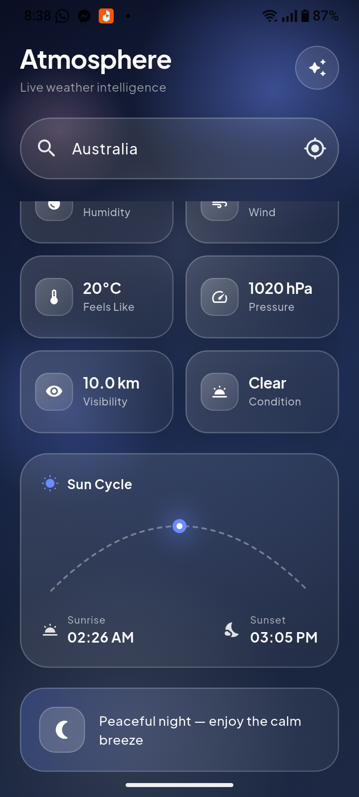

 <div align="center">



<br>

# Sky Cast

### Weather, Simplified.

A beautifully designed Flutter weather application that displays real-time temperature in Celsius using weather API integration, wrapped in a clean, modern, and visually appealing user interface.

**Beautiful Design. Simple Experience. Real-Time Weather.**

</div>

---

## 📖 About

**Sky Cast** is a modern weather application built with Flutter, designed to deliver essential weather information through a clean, elegant, and user-friendly interface.

Powered by weather API integration, Sky Cast retrieves weather data and displays the temperature in degrees Celsius (°C). The application combines a visually appealing design with a simple user experience, making it easy to check the temperature without unnecessary complexity.

With its weather-inspired visual identity and minimal interface, Sky Cast focuses on presenting essential information in a clear and attractive way.

## ✨ Features

- 🌡️ **Real-Time Temperature** — Retrieve and display temperature data through a weather API.
- 🌍 **Weather API Integration** — Fetch weather information from the configured API provider.
- 🌡️ **Celsius Temperature Display** — Present temperature in degrees Celsius (°C).
- 🎨 **Beautiful User Interface** — A modern and visually appealing interface with a distinctive design.
- ☁️ **Weather-Inspired Design** — A visual experience inspired by the sky and weather.
- 🧊 **Minimal User Experience** — Focus on essential temperature information without unnecessary clutter.
- 📱 **Flutter-Based Application** — Built with Flutter for a consistent application experience across supported platforms.

## 🖼️ Application Preview

<div align="center">




<br>

*An elegant interface for a simple temperature experience.*

</div>

## 🛠️ Tech Stack

- **Framework:** Flutter
- **Programming Language:** Dart
- **Weather Data:** Weather API
- **UI Design:** Flutter Widgets and custom styling
- **Development Tools:** Flutter SDK, Dart SDK, Git, and GitHub

## 🚀 Getting Started

Follow these instructions to run Sky Cast on your local machine.

### Prerequisites

Before getting started, make sure you have installed:

- [Flutter SDK](https://docs.flutter.dev/get-started/install)
- [Dart SDK](https://dart.dev/get-dart) (included with Flutter)
- [Git](https://git-scm.com/)
- An IDE such as [Visual Studio Code](https://code.visualstudio.com/) or [Android Studio](https://developer.android.com/studio)

Verify your Flutter installation:

```bash
flutter doctor
```

### Installation

**1. Clone the repository**

```bash
git clone https://github.com/rifathossain18/sky-cast.git
```

**2. Navigate to the project directory**

```bash
cd sky-cast
```

**3. Install dependencies**

```bash
flutter pub get
```

**4. Configure the Weather API**

Sky Cast uses a weather API to retrieve temperature information.

Configure your API key and any required settings according to your application's implementation.

Do not commit private API credentials to a public repository.

**5. Run the application**

Connect a supported device or start an emulator, then execute:

```bash
flutter run
```


## 🌦️ How It Works

1. The application requests weather data from the configured API.
2. The API returns weather information for the requested location.
3. Sky Cast processes the relevant response data.
4. The application displays the temperature in Celsius through its user interface.

The exact workflow depends on the API provider and the implementation of the application.

## 🔐 API Configuration & Security

Sky Cast relies on weather API integration to retrieve temperature information.

To configure the API:

1. Select or use the weather API provider configured for your project.
2. Obtain an API key if required.
3. Add the necessary configuration using the method expected by your application.
4. Verify that the application can successfully retrieve and display weather data.

**Security recommendations:**

- Never commit private API keys or credentials to a public repository.
- Add local secret files to `.gitignore`.
- Provide an `.env.example` file if your project uses environment variables, without including actual secrets.
- Remember that API keys embedded in a distributed Flutter application can potentially be extracted. Use provider restrictions and a backend proxy where appropriate.

## 🎯 Project Goals

Sky Cast is built around three core principles:

- **Simplicity** — Keep weather information easy to understand.
- **Visual Quality** — Deliver a polished and attractive interface.
- **Usability** — Make temperature information accessible with minimal effort.

## 🔮 Future Improvements

Potential improvements for future versions include:

- Further UI refinements.
- Improved loading and error states.
- Enhanced accessibility.
- Additional weather information, if desired.
- Performance and code-structure improvements.

These are possible future enhancements, not claims about existing functionality.

## 🤝 Contributing

Contributions, suggestions, and feedback are welcome.

To contribute:

1. Fork this repository.
2. Create a new branch:

   ```bash
   git checkout -b feature/your-feature-name
   ```

3. Make your changes.
4. Commit your changes:

   ```bash
   git commit -m "Improve: describe your changes"
   ```

5. Push your branch:

   ```bash
   git push origin feature/your-feature-name
   ```

6. Open a Pull Request describing your contribution.

## 🐛 Issues & Feedback

Found a bug or have an idea to improve Sky Cast?

Open an issue in the repository and include a clear description of the problem or suggestion. For bugs, include the steps needed to reproduce the issue whenever possible.


## 👨‍💻 Author

**MD Rifat Hossain**

- GitHub: [@rifathossain18](https://github.com/rifathossain18)


---

<div align="center">

### 🌤️ Sky Cast

**Weather, Simplified.**

*Beautiful Design. Simple Experience. Real-Time Weather.*

</div>
